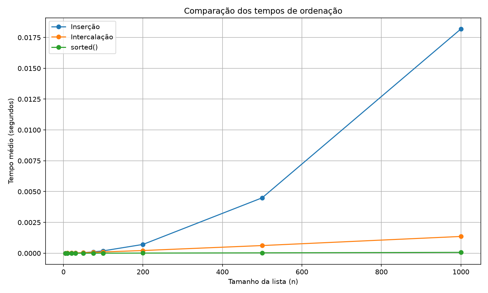
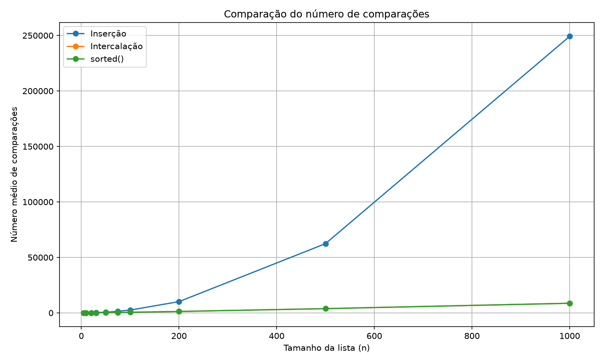

# Relatório — Comparação de Algoritmos de Ordenação

## 1. Objetivo

O objetivo deste trabalho é implementar e comparar os algoritmos de ordenação por inserção e por intercalação, analisando o tempo de execução e o número de comparações realizadas. Também foi utilizado o método nativo `sorted()` da linguagem Python como referência.

Os testes foram realizados com listas aleatórias de tamanhos 5, 10, 20, 30, 50, 75, 100, 200, 500 e 1000. Para cada tamanho, foram feitas 10 repetições, utilizando a média dos resultados para gerar os gráficos.

## 2. Metodologia

Foram implementados os seguintes métodos:

- **Inserção:** percorre a lista e posiciona cada elemento na posição correta em relação aos elementos anteriores.
- **Intercalação:** divide a lista em partes menores, ordena essas partes recursivamente e depois as intercala.
- **`sorted()`:** função nativa do Python, utilizada para comparar o desempenho com os algoritmos implementados.

Os tempos foram medidos utilizando `time.perf_counter()`. As comparações contabilizadas nos algoritmos próprios correspondem às comparações entre valores dos elementos. Para o `sorted()`, foi utilizada uma classe auxiliar que contabiliza as chamadas ao operador `<`.

Em cada repetição, os resultados dos três métodos foram comparados para verificar se produziam a mesma lista ordenada.

## 3. Resultados dos tempos de execução

A tabela apresenta os tempos médios obtidos nas medições, em segundos.

| Tamanho (n) | Inserção | Intercalação | `sorted()` |
|---:|---:|---:|---:|
| 5 | 0,00000156 | 0,00000355 | 0,00000045 |
| 10 | 0,00000359 | 0,00000861 | 0,00000072 |
| 20 | 0,00000917 | 0,00001697 | 0,00000133 |
| 30 | 0,00001648 | 0,00002362 | 0,00000132 |
| 50 | 0,00004898 | 0,00004821 | 0,00000262 |
| 75 | 0,00010943 | 0,00007511 | 0,00000424 |
| 100 | 0,00019203 | 0,00010477 | 0,00000563 |
| 200 | 0,00071349 | 0,00021871 | 0,00001168 |
| 500 | 0,00449579 | 0,00062297 | 0,00003026 |
| 1000 | 0,01819224 | 0,00136049 | 0,00007098 |

### Gráfico dos tempos

Observa-se que a inserção apresenta bons resultados para listas pequenas, mas seu tempo cresce consideravelmente com o aumento do tamanho da lista. A intercalação passa a apresentar vantagem por volta de 50 elementos. O `sorted()` obteve os menores tempos em todos os tamanhos testados.

## 4. Resultados do número de comparações

A tabela apresenta a média de comparações realizadas em cada tamanho de lista.

| Tamanho (n) | Inserção | Intercalação | `sorted()` |
|---:|---:|---:|---:|
| 5 | 8,1 | 7,1 | 9,4 |
| 10 | 29,6 | 22,4 | 24,1 |
| 20 | 113,2 | 64,0 | 64,3 |
| 30 | 240,0 | 110,6 | 111,3 |
| 50 | 648,3 | 223,4 | 218,5 |
| 75 | 1447,8 | 376,5 | 374,0 |
| 100 | 2539,1 | 541,8 | 538,1 |
| 200 | 10138,8 | 1277,7 | 1269,1 |
| 500 | 62397,1 | 3855,1 | 3828,4 |
| 1000 | 249204,6 | 8705,4 | 8653,4 |

### Gráfico das comparações

Os resultados mostram que o número de comparações da inserção cresce muito mais rapidamente. Para listas de 1000 elementos, por exemplo, a inserção realizou em média 249.204,6 comparações, enquanto a intercalação realizou 8.705,4.

## 5. Em qual tamanho a intercalação se torna mais rápida?

Nos testes realizados, a intercalação ficou ligeiramente mais rápida em listas de 50 elementos. Nesse tamanho, a inserção levou em média 0,00004898 segundos e a intercalação, 0,00004821 segundos.

A diferença é pequena e pode variar em novas execuções devido às características das listas aleatórias e às condições de execução do computador. Nos tamanhos seguintes, a intercalação apresentou vantagem mais evidente.

## 6. O ponto de mudança no tempo é igual ao das comparações?

Não. A intercalação apresentou menos comparações que a inserção desde o menor tamanho testado, mas isso não significa que tenha sido mais rápida em todos os casos.

Isso ocorre porque o tempo de execução não depende apenas das comparações entre elementos. A intercalação também realiza divisões recursivas, cria partes temporárias e copia elementos durante a combinação das listas. Em listas pequenas, esses custos adicionais podem fazer com que a inserção seja competitiva ou mais rápida.

Portanto, a quantidade de comparações ajuda a explicar o comportamento dos algoritmos, mas não determina sozinha o tempo total de execução.

## 7. Por que não escolher apenas pelo resultado do `sorted()`?

O `sorted()` apresentou os menores tempos em todos os testes. Entretanto, não seria adequado escolher um algoritmo apenas com base nesse resultado.

A função nativa do Python utiliza o Timsort, uma implementação otimizada que combina técnicas de ordenação e aproveita sequências já ordenadas. Além disso, os tempos podem variar conforme o ambiente de execução e as características dos dados.

Para escolher um algoritmo, também é necessário considerar a complexidade, a memória utilizada, o tipo de entrada e as necessidades da aplicação. A comparação com `sorted()` serve como referência de desempenho, mas não substitui a análise dos algoritmos.

## 8. Em qual situação a inserção é uma boa escolha?

A ordenação por inserção é adequada para listas pequenas ou listas que já estão quase ordenadas. Nesses casos, ela pode realizar poucas operações e aproveitar sua implementação simples, sem precisar dividir a lista recursivamente.

Também pode ser útil quando novos elementos precisam ser inseridos em uma sequência pequena que já está ordenada.

## 9. Complexidade dos algoritmos

- **Inserção:** \(O(n^2)\) no caso médio e no pior caso; \(O(n)\) no melhor caso, quando a lista já está ordenada.
- **Intercalação:** \(O(n \log n)\) nos casos melhor, médio e pior, considerando a implementação utilizada.
- **`sorted()`:** o Timsort apresenta \(O(n \log n)\) no caso médio e no pior caso e pode chegar a \(O(n)\) em entradas já ordenadas ou favoráveis.

A complexidade descreve como o custo tende a crescer conforme aumenta o tamanho da entrada. Os tempos medidos representam o comportamento observado no experimento.

## 10. Conclusão

Os testes demonstraram que a ordenação por inserção é competitiva em listas pequenas, mas seu desempenho piora rapidamente com o crescimento da entrada. A ordenação por intercalação apresentou melhor desempenho a partir de aproximadamente 50 elementos neste experimento e realizou muito menos comparações nas listas maiores.

O `sorted()` do Python obteve os menores tempos medidos, demonstrando a eficiência de uma implementação nativa otimizada. Conclui-se que a escolha do algoritmo deve considerar tanto a complexidade teórica quanto as características dos dados e os resultados práticos.

As medições foram realizadas em 10 repetições para cada tamanho, e os gráficos foram construídos a partir das médias. Os resultados podem variar em novas execuções.
